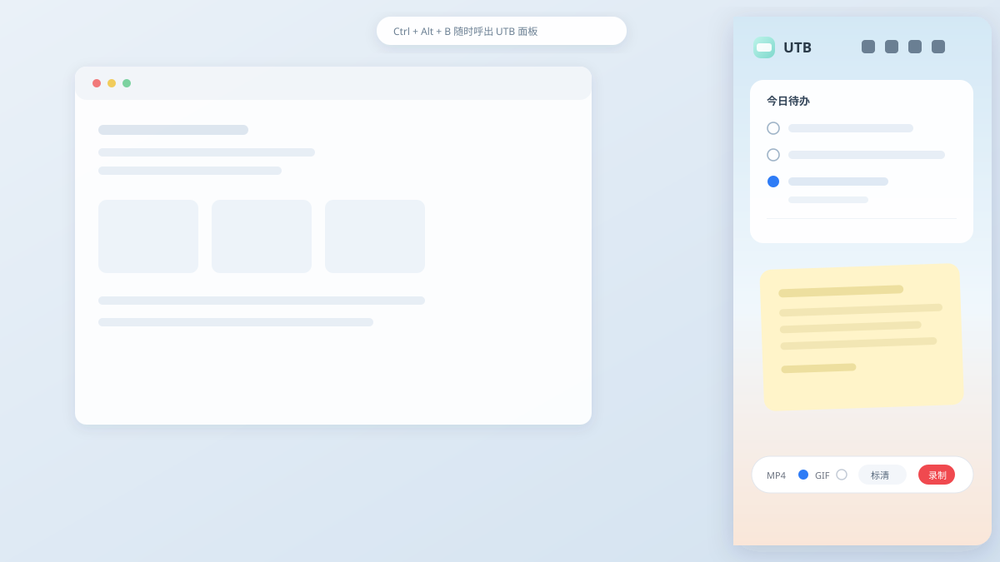

# 贴边 EdgeBar

一个贴在 Windows 屏幕右侧的抽屉式效率面板：便签、待办、截图标注、剪贴板历史、屏幕录制、纪念日、万年历、牛马计薪，都收在这一条里。

面板默认收起，只留一个把手；鼠标移过去自动展开，也可以按 `Ctrl + Alt + B` 随时呼出。



## 下载安装

到 [Releases](../../releases) 下载最新的 `EdgeBar-setup-*.exe`，双击安装即可。

- 安装目录可以自己选，默认 `D:\Programs\EdgeBar`
- 自包含 .NET 8 运行时，**不需要**额外安装 .NET
- 支持覆盖升级，安装程序会先结束正在运行的旧版本
- 卸载后数据目录会保留，重装不丢数据

系统要求：Windows 10 2004 及以上 / Windows 11，64 位。

> 精简版 Windows（N / KN 版本）需要安装「Media Feature Pack」，否则录屏不可用。

## 功能

### 贴边面板
- 抽屉式展开/收起，把手位置、面板宽度、圆角、透明度都可调
- 浅色 / 深色主题，奶油、海、樱花、森林、星空、极光 6 套插画背景，切换无需重启
- 顶部工具坞可自定义，最多放 4 个常用工具
- 托盘图标、开机自启、快捷键

### 便签
- 桌面级悬浮便签，可拖动、置顶、调大小
- 字号随便签尺寸等比缩放，长文本可滚动
- 最多同时贴 12 张

### 待办 / 纪念日 / 万年历 / 牛马计薪
- 待办支持日、周、月视图与纪念日分类，可提醒
- 万年历、农历与节假日
- 按工资和工作时间实时计算今天的收入

### 截图与标注
- 区域截图、全屏截图、窗口截图，`Ctrl + Alt + A` 呼出
- 箭头 / 直线、画笔、矩形（空心/实心）、文字、马赛克、橡皮（编辑橡皮 / 原图橡皮）
- 颜色支持色盘、RGBA 滑杆、Hex、屏幕取色
- 6 档笔触大小；选择工具可选中、移动已绘制的箭头/直线/矩形/文字
- `Ctrl + 滚轮` 以光标为中心缩放，放大后右键拖拽平移
- 撤销 / 重做、清空、复制并关闭、保存 PNG、贴到桌面
- 截图保存目录可在设置里修改

### 屏幕录制
- `Ctrl + Alt + S` 呼出：单击录制整个屏幕，拖动自定义范围，四周圆点可调整
- 浮动工具条：MP4 / GIF、标清 / 高清、系统声音开关、麦克风开关
- 录制中的控制条带计时和停止，**不会被录进画面**
- MP4：H.264 + AAC，支持系统声音和麦克风混音
- GIF：10fps、最长边 800px，无音轨
- 文件保存在 `视频\贴边录屏`

### 剪贴板历史
- `Ctrl + Alt + V` 呼出浮窗，保留最近 60 条
- 文字可右键修改，图片可右键贴到桌面或先编辑再贴
- 图片只保留缩略图，原图按需加载，避免吃内存

## 快捷键

| 快捷键 | 功能 |
| --- | --- |
| `Ctrl + Alt + B` | 展开 / 收起面板 |
| `Alt + N` | 新建便签 |
| `Ctrl + Alt + A` | 区域截图 |
| `Ctrl + Alt + V` | 剪贴板浮窗 |
| `Ctrl + Alt + S` | 屏幕录制 |
| `Esc` | 取消 / 关闭当前浮层 |

## 从源码构建

需要 .NET 8 SDK。

```powershell
cd EdgeBar
dotnet publish -c Release -r win-x64 --self-contained true `
  -p:PublishSingleFile=true `
  -p:IncludeNativeLibrariesForSelfExtract=true `
  -p:EnableCompressionInSingleFile=false `
  -o publish
```

> 不要开启单文件压缩：压缩后的程序集会在启动时解压进内存，实测多占约 100MB 私有内存。

打包安装程序需要 [Inno Setup 6](https://jrsoftware.org/isinfo.php)：

```powershell
ISCC.exe Installer\EdgeBar.iss
```

生成的安装包在 `Installer\Output\`。

## 项目结构

```
EdgeBar/
├─ Assets/            图标与主题背景插画
├─ Converters/        WPF 值转换器
├─ Installer/         Inno Setup 安装脚本
├─ Models/            AppState、便签、待办等数据模型
├─ Services/          存储、热键、剪贴板、截图、录屏、托盘、Gitee 同步
├─ Themes/            亮色/暗色资源字典与控件样式
├─ Views/             各功能页面与浮窗
├─ App.xaml.cs        启动、单实例、主题、便签窗口管理
└─ MainWindow.xaml    贴边面板主窗口
```

## 数据与隐私

- 所有数据默认保存在 `%APPDATA%\EdgeBar`，可在设置里迁移到其他盘
- 便签、待办、剪贴板、截图、录屏都只在本地，不会上传
- 只有在设置里主动配置 Gitee 仓库后，才会把 `data.json` 同步到你的私人仓库
- 剪贴板会跳过密码管理器标记的内容

## 实现说明

- WPF / .NET 8，单文件自包含发布
- 截图与录屏使用 GDI 抓屏，录屏经 Windows Media Foundation 编码 H.264 / AAC
- 录屏未启用硬件编码：部分 Intel 显卡驱动在非 16 对齐的选区宽度下会崩溃，软件编码更稳
- 录屏控制条通过 `SetWindowDisplayAffinity(WDA_EXCLUDEFROMCAPTURE)` 排除出捕获范围
- GIF 使用自研流式 LZW 编码器，逐帧写入，不在内存里缓存整段录屏

## 已知限制

- 录屏为软件编码，1080p 录制大约占用 0.4 个 CPU 核心
- GIF 体积较大，适合几秒到十几秒的短片段
- 仅支持 Windows
